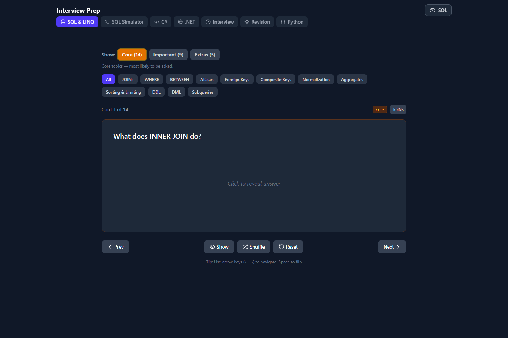
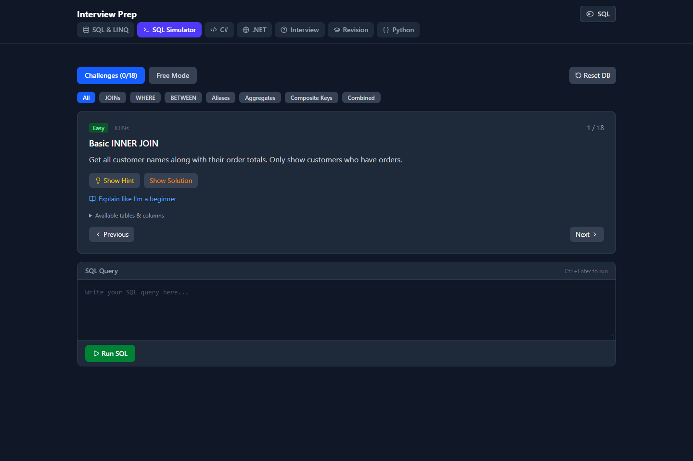
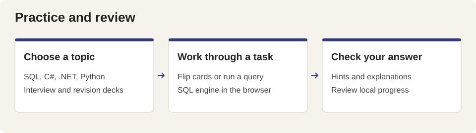

# Interview Prep

A browser study app with flashcards for SQL and LINQ, C#, .NET, Python, general interview questions and revision. The SQL Simulator runs a local SQLite database through sql.js and offers challenges, hints, solutions and a free-query mode.







## Run locally

```powershell
npm ci
npm run dev
```

Open the Vite URL printed in the terminal. `npm run build` creates `dist/`; `npm run preview` serves that build. `npm run lint` runs ESLint.

## Study

Choose a topic tab. In a flashcard deck, use Left/Right to move and Space to flip. The SQL/LINQ toggle changes the relevant study presentation. In the simulator, select a challenge, enter a query, run it and inspect the returned rows. Hints, explanations and the supplied solution can be revealed separately.

Browser local storage retains selected tabs, syntax mode and deck state. The simulator initializes its sample database in memory; it is a practice environment rather than a connection to an external database. Its LINQ conversion supports the patterns implemented in `src/utils/linqToSql.js`, not arbitrary C# execution. The SQLite WebAssembly binary is served from `public/sql-wasm.wasm`.

## Repository map

| Path | Purpose |
| --- | --- |
| `src/App.jsx` | Topic navigation, syntax choice and keyboard controls |
| `src/components/Flashcards.jsx` | Study decks and local deck state |
| `src/components/SqlSimulator.jsx` | SQLite practice interface |
| `src/data/` | Flashcards, challenges and database setup |
| `src/utils/linqToSql.js` | Supported LINQ-to-SQL conversions |
| `public/` | Local WebAssembly engine and static assets |
| Root study-plan Markdown files | Longer interview preparation notes |
